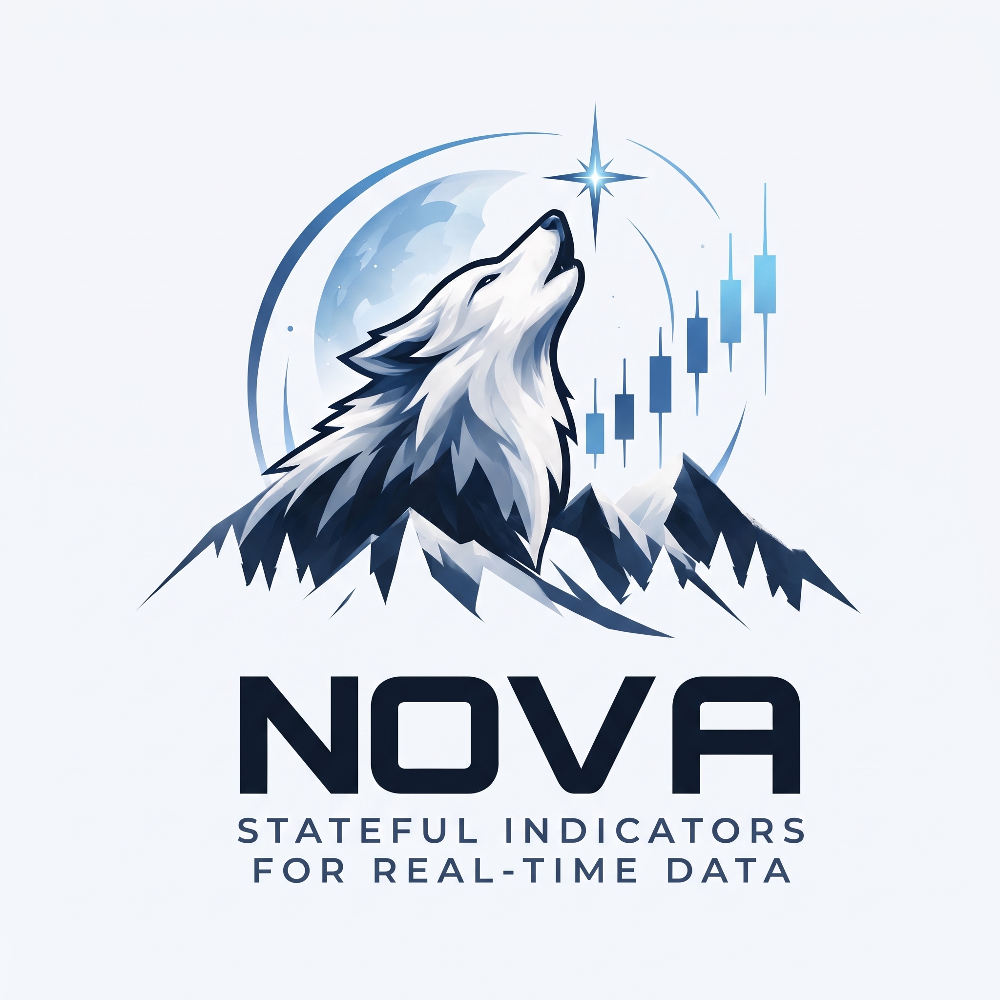

<p align="center">
  <picture>
    <source media="(prefers-color-scheme: dark)" srcset="assets/nova-dark-text.jpg">
    
  </picture>
</p>

[](https://discord.gg/QwKmaaeW56)

# Nova

Nova is a stateful technical-analysis library for quantitative finance and real-time market data. Each indicator consumes one sample or candle at a time and keeps its own computation state, so the same code serves candle-by-candle execution, backtesting and live processing. Its focus is on unconventional or under-used indicators (adaptive filters, volatility-normalized measures, market-structure metrics) rather than a catalogue of standard oscillators.

> **Status: early development.** Only one indicator (ALMA) is implemented so far. It is built on the shared abstractions in [`nova-ta-core`](https://crates.io/crates/nova-ta-core); planned indicators are tracked in [`TODO.md`](TODO.md). APIs may change.

## Design goals

- **Incremental processing.** Feed one sample at a time instead of re-processing full batches.
- **Stateful indicators.** An indicator owns its state; callers pass no history.
- **Composable.** An indicator built from other indicators holds them as fields and drives them from its own `update`.
- **Consistent behavior across languages.** Each indicator is meant to be implemented once, with the same maths and warm-up semantics in every binding.
- **Shared foundation** for trading applications, backtesting and real-time processing.

Currently only the Rust implementation exists. Everything involving other languages is a goal, not a feature (see [Language interoperability](#language-interoperability)).

## Quick start

```rust
use nova::{Alma, error::NovaResult};
use nova_ta_core::{Indicator, Ohlc};

fn main() -> NovaResult<()> {
    // period 5, offset 0.85, sigma 6
    let mut alma = Alma::<f64>::new(5, 0.85, 6)?;

    for close in [10.0, 11.0, 12.0, 11.5, 12.5, 13.0] {
        let candle = Ohlc::prices(close, close, close, close);
        let value = alma.update(candle)?;
        if alma.ready() {
            println!("alma = {value:.4}");
        } else {
            println!("warming up (partial = {value:.4})");
        }
    }

    alma.reset();
    assert!(!alma.ready());
    Ok(())
}
```

`Indicator`, `Ohlc` and the other core types come from `nova-ta-core`, which `nova` does not re-export, so add both crates as dependencies.

Key points of the contract:

- `update` always returns a value. Until `ready()` is `true` it is a *partial* result whose seeding each indicator documents; the caller decides whether to use it.
- `update` is fallible: `Result<Output, Error>`. Nova indicators return `NovaError`, where a failing numeric backend surfaces as `NovaError::Number`; with `f64` this never happens. After an error the state is unspecified, so call `reset()` before reuse.
- `reset()` restores the just-constructed state and restarts warm-up.

## Available indicators

| Indicator | Type | Description |
| --- | --- | --- |
| ALMA | `Alma<T: Real>` | Arnaud Legoux Moving Average over candle closes. |

**ALMA** details, as implemented:

- `Alma::new(period, offset, sigma)`: `period >= 1`, `offset` in `[0, 1]`, `sigma >= 1`; otherwise returns `NovaError`.
- Weights for position `i` (0 = oldest): `exp(-(i - m)^2 / (2 s^2))`, with `m = floor(offset * (period - 1))` and `s = period / sigma`.
- Input is `Ohlc<T>` (only `close` is used); output is `T`: `sum(close_i * w_i) / sum(w_i)`.
- Warm-up: `ready()` is `true` once `period` candles have been seen. Before that, the output uses only the newest `len` weights, normalised by their sum, so it is a valid but partial result (a single candle returns its own close).
- `reset()` clears the candles and keeps the weights.

Planned work, in priority order: more adaptive filters (KAMA, LSMA), structure measures (Efficiency Ratio, Vertical Horizontal Filter, Donchian breakout) and robust statistics (rolling regression slope and R�, robust Z-score). See [`TODO.md`](TODO.md).

## Architecture

- **`nova-ta-core`** defines the abstractions: the `Indicator` trait (`update`, `ready`, `reset`), the `Num` and `Real` numeric traits with fallible arithmetic (implemented for `f64`), the `Ohlc<N>` candle type and the fixed-capacity rolling `Window<T>`. It contains no indicators. See its [README](https://crates.io/crates/nova-ta-core) for details.
- **`nova`** (this crate) holds the concrete indicators, written once against those traits, plus `NovaError` / `NovaResult`. Source layout: `src/filters`, `src/structure`, `src/statistics`, `src/volatility`.

## Language interoperability

The goal is to make each indicator available with consistent behavior in Rust, Python and TypeScript, and possibly other languages later through suitable bindings, potentially including [UniFFI](https://github.com/mozilla/uniffi-rs). No bindings exist in this repository today, and no cross-language behavior guarantees have been established.

## Chipa integration

Nova is being built to support the [Chipa](https://chipaeditor.com) ecosystem, in particular the new Chipa-Flow language for expressing trading strategies, where indicators are building blocks. This is work in progress: the Chipa-Flow version described on the public website does not use Nova, and Nova is meant to remain useful as a standalone library. A beta is available in [Chipa Studio](https://studio.chipaeditor.com).

## Installation and development

```sh
cargo add nova-ta
```

To work on Nova itself:

```sh
git clone https://github.com/Rick-29/nova.git
cd nova
cargo build
cargo test
cargo fmt
cargo doc --no-deps
```

## Using Nova?

Nova is free to use in personal, commercial and closed-source projects. If you build something with it, we'd love to hear about it (a project name or link is plenty); there are no fees or obligations.

## Help and community

Questions or feedback? Join the [Nova Discord](https://discord.gg/QwKmaaeW56).

## License

Licensed under the [MIT license](LICENSE).
